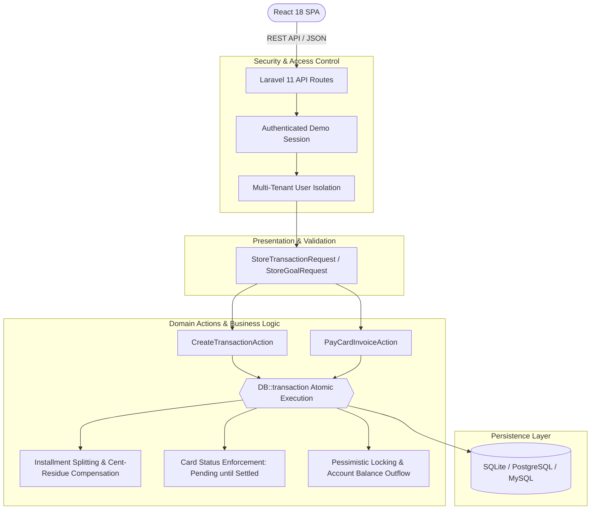

# FinTrack — Enterprise SaaS Showcase Demo

[](https://github.com/YuriTreichel/fintrack-showcase/actions)
[](https://phpstan.org/)
[](https://pestphp.com/)
[](https://laravel.com/)
[](https://react.dev/)
[](https://tailwindcss.com/)
[](LICENSE)

An enterprise-grade, high-performance financial management SaaS engineered with **Laravel 11**, **React 18**, and clean architectural patterns. Built to demonstrate mathematical ledger consistency, multi-tenant isolation, atomic installment distribution, and full-stack software craftsmanship.

> 🌐 **Live Interactive Demo:** [fintrack-showcase.onrender.com](https://fintrack-showcase.onrender.com)  
> 💡 *Automatically pre-loaded with comprehensive demo data. Recruiters and engineering leaders can test and evaluate all features immediately without registration.*

---

## 🧭 About this Showcase

This repository is a **production-ready technical showcase** extracted from the commercial SaaS platform **FinTrack** ([fintrackweb.com.br](https://fintrackweb.com.br)). It showcases the complete, uncompromised feature set of a mature SaaS application:

* **Interactive Financial Dashboard:** High-level net worth, monthly income, monthly outflow, savings rate, liquidity gauges, and asset breakdown.
* **Full-Spectrum Ledger & Transactions:** Filtering by category, bank account, credit card, payment status, recurring items, and date intervals.
* **Credit Card Management:** Dynamic invoice cycles, closing date calculations, and atomic settlement with account outflow reconciliation.
* **Banking & Multi-Account Management:** Checking, savings, investment, and cash holdings with balance auditing.
* **Budgeting Engine & Category Health:** Target caps, progress meters, threshold alerts, and variance analysis.
* **Financial Goals & Debt Snowball/Avalanche:** Projection models, target completion dates, and interest-rate prioritization algorithms.
* **Analytics & Financial Reports:** Cash flow progression, spending composition charts, and exportable data summaries.
* **Simulated Billing & Checkout:** Full integration flow with safe mock billing—allowing immediate testing of subscription upgrades without real charges.

---

## 🏛 Architecture & Domain Design

The system implements **Single-Responsibility Actions**, **Domain Services**, **Form Requests**, and strict **Atomic Database Transactions** to enforce ledger integrity.



---

## ✨ Key Technical Highlights & Engineering Decisions

### 1. Zero Floating-Point Drift Strategy
In multi-installment financial transactions, integer division of monetary amounts frequently results in repeating fractions (e.g., $100.00 / 3 = $33.3333...). 
- The domain calculates exact cents and mathematically compensates the remainder cents directly onto the first installment.
- Guarantees `sum(installments) === total_amount` with zero floating point variance across all financial statements.

### 2. Pessimistic Concurrency on Invoice Settlements
Credit card invoice settlement (`PayCardInvoiceAction`) utilizes pessimistic database locks (`lockForUpdate()`):
- Prevents double-settlement race conditions from concurrent user clicks or redundant webhook requests.
- Atomically transitions all invoice items to `Paid` while simultaneously creating the corresponding single outflow deduction on the selected bank account.

### 3. Multi-Tenant IDOR Guard & Boundary Verification
Every query across accounts, cards, budgets, and transactions strictly applies tenant isolation:
- Direct Object Reference (IDOR) attempts return automatic HTTP 403 / 404 responses.
- Enforced both at the query builder scope and covered by Pest automated security regression tests.

### 4. Optimized Modern Frontend Stack
- Built with **React 18**, **Tailwind CSS v4** (using the new `@tailwindcss/vite` engine), **Lucide React**, **Recharts**, and **Framer Motion**.
- Production build delivers code-split route chunks, lazy-loaded modals, and sub-second navigation transitions.

### 5. Multi-Stage Docker Containerization
- **Builder Stage:** Node.js Alpine container builds and optimizes frontend assets.
- **Runtime Stage:** Lightweight PHP 8.3 FPM + Nginx Alpine image, standalone fastcgi routing, automated database seeding, and production OPcache optimization.

---

## 🧪 Testing Suite & Static Analysis

FinTrack enforces strict code quality and continuous automated testing across all pull requests:

```bash
# Run unit, feature, and security tests (Pest PHP)
composer test

# Run static analysis (PHPStan Level 8 / Larastan)
composer analyse

# Run PSR-12 code style enforcement (Laravel Pint)
composer lint
```

Continuous Integration runs on every push with a GitHub Actions matrix testing against **PHP 8.2, 8.3, and 8.4**.

---

## 🚀 Quickstart & Local Setup

### Option 1: Docker (Recommended)

Run the full stack with a single command:

```bash
# 1. Clone repository
git clone https://github.com/YuriTreichel/fintrack-showcase.git
cd fintrack-showcase

# 2. Setup environment
cp .env.example .env

# 3. Spin up containers
docker compose up -d --build

# 4. Initialize database and demo seeds
docker compose exec app php artisan key:generate
docker compose exec app php artisan migrate --seed
```

Open your browser at `http://localhost:8000`.

---

### Option 2: Local CLI

```bash
# Install backend dependencies
composer install

# Install frontend dependencies and build assets
npm install
npm run build

# Configure environment and database
cp .env.example .env
php artisan key:generate
touch database/database.sqlite
php artisan migrate --seed

# Launch local server
php artisan serve
```

---

## 👤 Author

Developed by **Yuri Fernandes**  
* Senior Fullstack & Backend Software Engineer | Architect  
* [GitHub Profile](https://github.com/YuriTreichel)  
* [Live Showcase Demo](https://fintrack-showcase.onrender.com)
