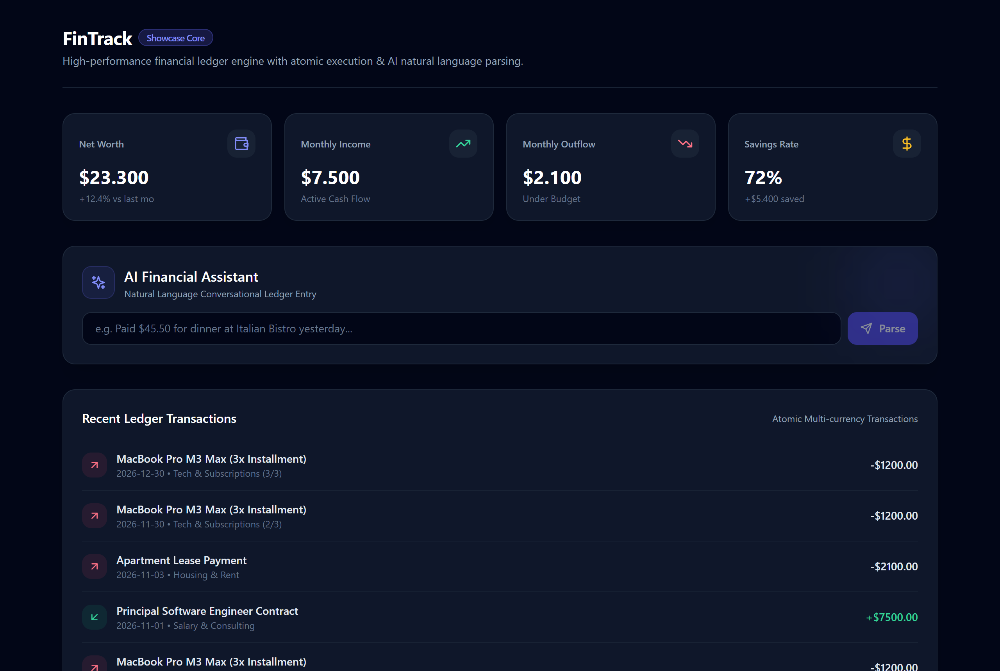
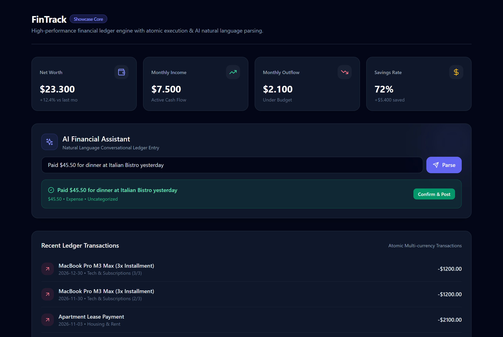
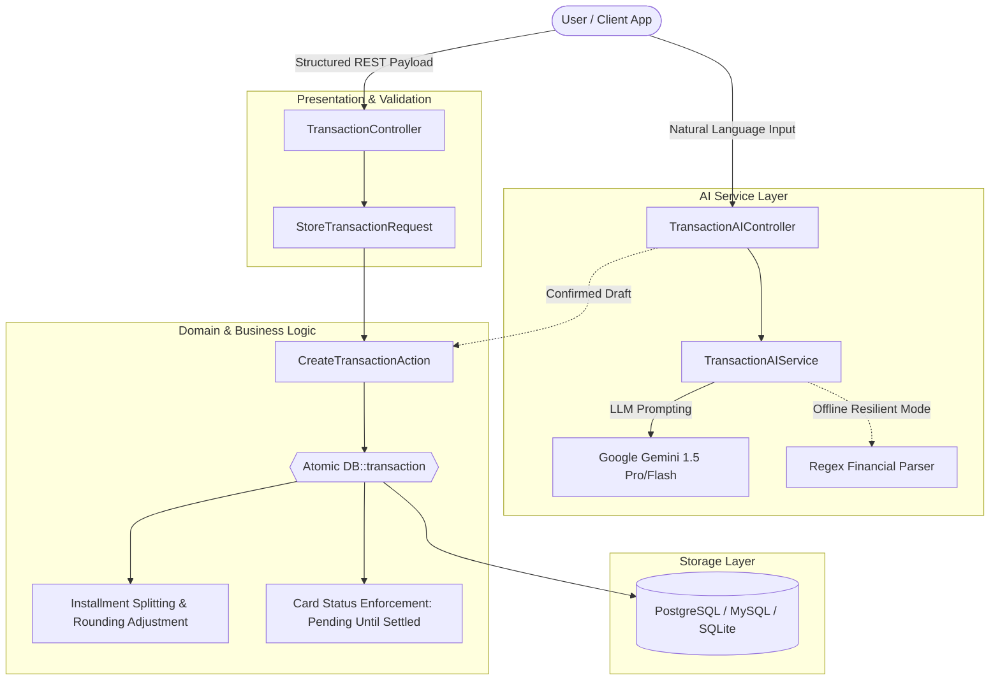

# FinTrack Core & AI Engine Showcase

[](https://github.com/YuriTreichel/fintrack-showcase/actions)
[](https://phpstan.org/)
[](https://pestphp.com/)
[](https://laravel.com/)
[](LICENSE)

An enterprise-grade personal finance ledger and AI natural language transaction processor designed for high concurrency, mathematical consistency, and clean architectural separation.

> **Note:** This repository is an open-source technical showcase extracted from a proprietary SaaS application ([fintrackweb.com.br](https://fintrackweb.com.br)) to demonstrate domain modeling, multi-tenant isolation, idempotent ledger processing, LLM integration, and senior software engineering patterns.

---

## 📸 Showcase Preview

<div align="center">
  
  <p align="center"><em>Interactive High-Performance Financial Dashboard & Aggregated Metrics</em></p>
</div>

<br/>

<div align="center">
  
  <p align="center"><em>Conversational AI Financial Intake with Extraction Draft & Real-Time Confirmation</em></p>
</div>

---

## 🏛 Architecture & Domain Design

The system implements **Single-Responsibility Actions**, **Data Transfer Objects (Resources)**, and strict **Database Transaction Isolation** to manage financial ledger events and credit card reconciliation.



---

## ✨ Key Technical Highlights

1. **Atomic Installment Generation & Floating-point Protection:**
   * Installments are distributed across dynamic billing periods.
   * Rounding residues (cents) are mathematically compensated on the initial installment to guarantee `sum(installments) == total_amount` with zero floating point drift.
2. **Card Invoice Reconciliation Engine:**
   * Credit card purchases are natively registered as `Pending` liabilities.
   * Execution of `PayCardInvoiceAction` uses `lockForUpdate()` to avoid double-settlement race conditions, transitioning items to `Paid` while automatically logging a single outflow entry on the payment bank account.
3. **Conversational AI Financial Extraction (`TransactionAIService`):**
   * Integrates Google Gemini 1.5 Flash via structured prompt engineering.
   * Returns clarification prompts when critical financial parameters (such as amount or explicit intent) are missing.
   * Includes an automated fallback parser for test resilience and zero-dependency offline runs.
4. **Code Quality & Static Analysis:**
   * Configured for **PHPStan Level 8** (highest non-strict tier in Larastan).
   * 100% PSR-12 compliant code formatted via **Laravel Pint**.

---

## 🚀 Quickstart & Local Setup

### Option 1: Docker (Recommended)

Run the full stack (PHP 8.3 FPM + Nginx + SQLite) with a single command:

```bash
# 1. Clone repository
git clone https://github.com/YuriTreichel/fintrack-showcase.git
cd fintrack-showcase

# 2. Setup environment
cp .env.example .env

# 3. Spin up containers
docker compose up -d --build

# 4. Run migrations & realistic seeds
docker compose exec app php artisan key:generate
docker compose exec app php artisan migrate --seed
```

Open your browser at `http://localhost:8000`.

---

### Option 2: Local CLI

```bash
composer install
npm install && npm run build
cp .env.example .env
php artisan key:generate
touch database/database.sqlite
php artisan migrate --seed
php artisan serve
```

---

## 🧪 Testing Suite & Quality Gates

The test suite covers atomic ledger execution, floating-point installment residue compensation, invoice settlement concurrency, multitenant security boundaries (IDOR prevention), and AI natural language parsing:

```bash
# Execute Pest test suite (Unit & Feature tests)
composer test

# Run PHPStan static analysis
composer analyse

# Run Laravel Pint code style enforcement
composer lint
```

---

## 📐 Key Architectural Trade-offs & Decisions (ADRs)

1. **Why Single-Responsibility Actions instead of Fat Services/Models?**
   * Decoupling domain workflows like `CreateTransactionAction` and `PayCardInvoiceAction` allows isolated testing, strictly atomic transactions, and zero side-effects across related models.
2. **Zero Floating-Point Drift Strategy:**
   * In multi-installment transactions, integer division of currency frequently produces repeating decimals (e.g. \$100.00 / 3 = \$33.3333...). We compute the base installment and mathematically inject the remainder cents into the initial period, guaranteeing `sum(installments) === total_amount`.
3. **Pessimistic Concurrency on Invoices:**
   * `PayCardInvoiceAction` leverages `lockForUpdate()` during settlement queries to prevent double-spending anomalies or duplicate payouts when concurrent webhooks or user clicks trigger invoice settlements.
4. **Hybrid LLM + Deterministic Offline Fallback:**
   * The AI ingestion pipeline integrates Google Gemini 1.5 with prompt validation, yet degrades gracefully to a regex heuristic parser if offline or when API credentials are absent, ensuring uninterrupted CI testability.

---

## 👤 Author

Developed by **Yuri Fernandes**  
* Senior Fullstack & Backend Engineer | Software Architect  
* [LinkedIn](https://linkedin.com) • [GitHub](https://github.com/YuriTreichel)

